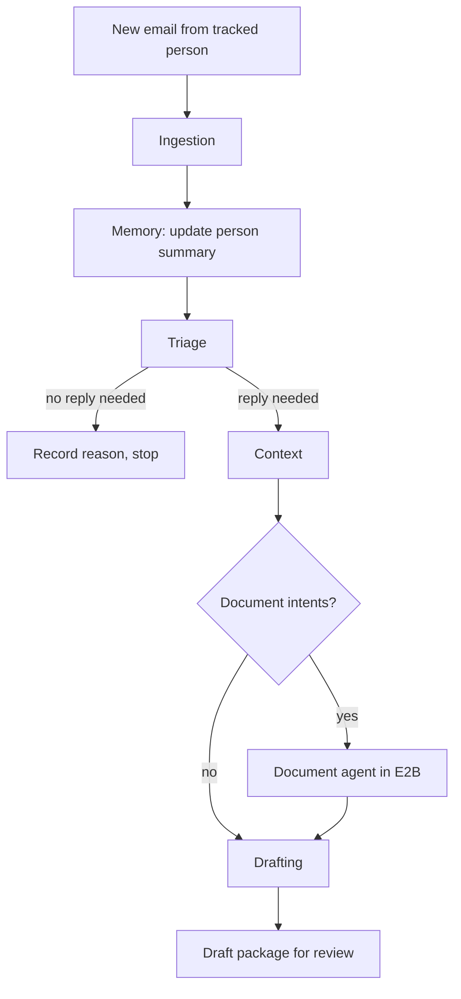

# AI Mail App — Build Spec for Claude Code

Sep 27, 2026 · @Jugtej

## How to use this document

This is the build spec for Claude Code. Paste it in, or save it in the repo as `docs/SPEC.md` and tell Claude Code to read it first.

Half of the app already exists, so Claude Code's first job is to learn that code, not to start fresh. Section "Step 0" makes it audit the repo, write a plan, and stop for your answers before it changes anything.

The instruction to Claude Code is:

> Read this whole spec. Then do Step 0 exactly as written. Do not implement anything until I have answered any new questions and approved `docs/PLAN.md`.

## Product vision and what already exists

The app is a local mail client where AI drafts replies, and edits or creates the attached files, for every email from a tracked person. The user reviews each draft, fills in the gaps, and sends it. The AI never sends anything itself.

### What the app does

- **Reads every email from a tracked person** along with that person's history and any files they sent.
- **Decides whether a reply is needed.** If it is, it writes one in the user's voice.
- **Leaves gaps it can't fill** as clear placeholders, for example `[[start-time]]`, instead of guessing.
- **Works on documents.** If the person asks for a change to an agreement, the AI edits the agreement, attaches the new version, and writes the user a note on what changed and where.
- **Uses templates.** If someone asks for an NDA, the AI takes the user's NDA template, fills it in for that person and deal, and attaches it.
- **Keeps everything locally.** Emails, summaries, every version of every received file, the final form of every AI-made file, templates, resources and the user profile all live in local folders.

### What is already built

| Area | State |
| --- | --- |
| IMAP sync | Working |
| Contact tracking | Working, basic |
| AI drafting | Working but limited: single prompt, no memory, no file handling |
| Person summaries | Not built |
| Attachment ingestion and versioning | Not built |
| Document editing in E2B | Not built |
| Templates | Not built |
| User profile and resources | Not built |
| Multi-agent orchestration | Not built |

Claude Code should extend the working parts. It should rewrite them only when there is a concrete reason, and only after putting tests around them.

## Step 0: audit and plan before coding

Claude Code writes two documents and a list of questions, then stops. It changes no application code in this step.

1. **Explore the repo.** Find out:
   - the stack, frameworks, and how the app is run and built
   - how IMAP sync stores messages, threads and attachments
   - the data model for contacts, threads and messages
   - how tracking marks a person as tracked
   - how the current draft feature builds its prompt, calls the model, and stores the draft
   - what tests exist, and what has none
2. **Write `docs/ARCHITECTURE_CURRENT.md`.** Cover what exists, what can be reused as is, what needs refactoring, and what is fragile.
3. **Write `docs/PLAN.md`.** Map every feature in this spec to phases. For each phase, list the modules it touches, the new modules it adds, the migrations it needs, and how to test it.
4. **List open questions.** The main product questions are already answered under "Decisions already made" at the end of this spec. List only new questions the code raises.
5. **Stop.** Wait for answers and plan approval before starting Phase 1.

While doing this, Claude Code must not rename, move or delete existing files.

## Per-person memory: running summary and thread handling

Each tracked person has one running summary, and their threads are part of it. There are no separate per-thread summaries.

### What the person summary holds

- **Who they are:** name, company, role, and how they relate to the user
- **How to write to them:** tone and formality, their language, how they sign off
- **Each active thread**, as a short entry:
  - what the thread is about
  - decisions made so far
  - open asks and commitments, and who owes what
  - dates that matter (deadlines, proposed meetings)
  - files exchanged, with links to the exact stored versions
- **Closed threads**, reduced to one line each

Store it as `contacts/<contact-id>/summary.md`, in a fixed section layout so both agents and people can read it.

### How it is kept up to date

- Update it incrementally whenever a message from or to the person arrives. Pass the model the current summary and the new message, and have it return the updated summary.
- Never regenerate the whole summary from scratch in normal operation. Provide a manual "rebuild summary" action for repairs.
- Keep the previous version of the summary when writing a new one, so a bad update can be rolled back.
- Sent replies count as new messages, so commitments the user makes are recorded too.

### What the drafting agents receive

1. The person summary
2. The **full current thread**, sent whole
3. The new message and the parsed content of its attachments
4. The user profile and any resources retrieved for this message

### When the thread is too long

If the thread goes over the context budget, cut it:

- keep the newest messages whole and drop the oldest first
- always keep the first message of the thread, since it usually states what the thread is for
- never cut the message being replied to
- rely on the person summary for what was dropped
- make the budget configurable, and log every time a thread was cut and by how much

Quoted history inside each email (the `> On Tuesday, X wrote:` blocks) should be stripped before counting. Otherwise every message repeats the whole thread.

## Triage and intent detection

Not every email needs a reply, so a triage step runs first on every incoming email from a tracked person. It decides whether to draft, and what kind of draft.

### Reply decision

| Decision | Meaning | Example |
| --- | --- | --- |
| `no_reply_needed` | Nothing to answer | "Thanks, got it!" |
| `needs_reply` | A text reply is enough | "Are we still on for Friday?" |
| `needs_reply_with_document` | The reply needs an edited or new file | "Please change the payment terms in the agreement" |
| `unsure` | The user should decide | Ambiguous or sensitive messages |

### Intents

One email can carry several intents. Triage extracts all of them, and each one becomes a task for the orchestrator:

- scheduling request ("when are you free?")
- question needing an answer
- document change request ("change clause 4")
- document request ("can you send an NDA?")
- document shared for review
- follow-up or chaser
- information only

### Output

Triage returns structured JSON: the decision, the intents, which attachments or stored documents each intent refers to, and a one-line reason. Store it with the message. The user can see why a draft was or wasn't made, and can force a draft on any email.

## Reply drafting with placeholders

The drafting agent writes a complete reply in the user's voice, and marks every fact it doesn't know as a placeholder for the user to fill.

### Example

Incoming: "Hi, when are you free to meet next week?"

Draft:

```
Hey Sam,

Would love to meet. I'm available from [[start-time]] to [[end-time]] on [[date]].

Thanks,
Regards,
<user name from profile>
```

### Placeholder rules

- One fixed syntax, `[[name]]`, so the UI can find, highlight and count placeholders.
- Names are short and self-explanatory: `[[start-time]]`, `[[price]]`, `[[signing-date]]`.
- Use a placeholder for any date, time, price, number, commitment or fact that isn't in the summary, thread, profile or resources.
- The same placeholder name used twice in one draft is filled once and applies everywhere.
- The same rules apply inside generated documents.

### Voice and content rules

- Follow the tone and sign-off from the user profile, adjusted to the person's formality in their summary.
- Answer every intent triage found, in the order the person asked.
- If a file is attached, mention it in the body ("I've attached the updated agreement").
- Never invent facts, and never agree to terms on the user's behalf.
- Keep it as short as a person would write it.

### Draft package

Each draft is saved as one package: reply text, attachments, change notes, triage reason, the list of placeholders, and the context used (summary version, whether the thread was cut, resources retrieved). The user can ask for a regenerate, with an optional instruction such as "make it shorter".

### Merging drafts

When a person sends several emails back to back in one thread, each email gets its own draft as it arrives. The user is then asked whether to merge them into one reply.

- The earlier drafts are not deleted or marked stale. They stay open side by side until the user merges, sends or discards them.
- A banner on the thread says, for example, "2 drafts for this thread. Merge into one reply?"
- **Text:** a merge rewrites the texts into one reply that answers every intent from every email. It is not pasted together. Placeholders from all the drafts carry over, and duplicates become one.
- **Attachments that are different documents** are combined: all of them go on the merged draft.
- **Attachments that are versions of the same document** are not combined. Only the latest version is kept, because it already contains the earlier changes. For example, if draft 1 carries `agreement_v3` and draft 2 carries `agreement_v4`, the merged draft carries only `agreement_v4`.
- The change notes are combined into one note per file, covering every change since the last version the other party saw.
- The drafts that were merged are kept in the thread's history, marked as merged.

Because of this rule, the second document edit must start from the version in the earlier draft (v3), not from the last version received. The document agent should always check for pending drafts on the same document before editing.

## Incoming attachments: ingestion and versioning

Every attachment a tracked person sends is saved, versioned, parsed, and passed to the agents along with the message.

### Versioning

- A "document" is one logical file across the thread, such as "the service agreement". Each file received for it is a new version: `attachments/<doc-id>/v1.pdf`, `v2.pdf`, and so on.
- `meta.json` records, for each version: sender, message id, received date, original filename, a file hash, and the version it replaced.
- An identical file sent again (same hash) is not stored twice. It is linked to the existing version.
- Deciding whether a new file is a new version of an existing document or a new document uses, in order:
  1. the same thread and a similar filename
  2. the thread context ("attached the revised agreement")
  3. content similarity to existing documents from that person
- When unsure, create a new document and let the user merge them in the UI.

### Parsing

| Type | What to extract |
| --- | --- |
| PDF | Text with page numbers; OCR for scanned pages |
| DOCX | Text with headings, clause numbers and tables |
| XLSX / CSV | Sheets as tables |
| Images | A description, and OCR if it contains text |
| TXT / MD | As is |

Store parsed text beside each version so it's parsed once. Page and clause positions must survive parsing, because change notes refer to them.

## Outgoing attachments: document editing in E2B

When a person asks for a change to a document, the document agent edits the latest version inside an E2B sandbox, attaches the result, and writes the user a change note.

### Example

The thread is about a service agreement. The person replies: "We need the payment terms changed to 45 days, and please add our new office address." The document agent:

1. finds the latest version of the agreement in storage
2. opens it in an E2B sandbox
3. makes both changes there
4. saves it as DOCX, and converts it to PDF because it's a contract
5. attaches it to the draft
6. writes the change note

### E2B rules

- All opening, editing and converting of files happens in the sandbox. Nothing is executed on the user's machine.
- Copy only the files the task needs into the sandbox, and copy only the final output back.
- One sandbox per task, closed when the task ends. Set a timeout, and report failures in the draft rather than dropping them silently.
- Build a sandbox template with the tools needed pre-installed: python-docx, openpyxl, LibreOffice (headless) for conversion, and a PDF text library.

### File formats

The AI reads any file type, but it only writes DOCX and XLSX. PDFs are made by converting.

| Direction | Formats |
| --- | --- |
| Read | Anything: PDF, DOCX, XLSX, CSV, images, text. Pass it to the model directly where the model accepts it; otherwise send the parsed text. |
| Write | DOCX and XLSX only |
| Send | DOCX, XLSX, or PDF converted from DOCX. Contracts and agreements are always sent as PDF. |

### Editing a PDF someone sent

PDFs can't be written, so:

1. The first time a PDF needs editing, rebuild it as a DOCX in the sandbox. Save that DOCX as the document's **working copy**.
2. Make every edit on the working copy.
3. Convert the working copy to PDF to send.
4. Next time, edit the working copy again, not the PDF. This avoids losing formatting through repeated round-trips.

If the other side sends a new PDF version, make a new working copy from it. If the rebuild loses formatting (tables, headers, signature blocks, images), say so in the change note.

### Change note

The change note is for the user only and is never sent. The other party always gets a clean file with no tracked changes or comments. It lists every change:

| File | Location | Before | After |
| --- | --- | --- | --- |
| Service\_Agreement\_v3.pdf | Page 4, clause 7.2 | "within 30 days" | "within 45 days" |
| Service\_Agreement\_v3.pdf | Page 1, parties | old address | new address from the email |

It also flags anything the agent couldn't do or wasn't sure about. No redlines are made.

### Storage

- AI-made files: save **only the final form**, in `generated/<thread-id>/`, plus its change note. No intermediate edit states.
- The DOCX working copy is the one extra file kept, next to the document's versions.
- Once the user sends the file, it becomes the next version of that document, so the thread's history stays complete.

## Templates

The user uploads templates once, and the AI fills them in for each person and deal when a thread asks for one.

### Example

The user is doing a deal, and the other side writes "Can you send over your NDA?". The AI:

1. matches the request to the user's NDA template
2. fills in the other party's name, company, address, the effective date and the deal purpose, using the thread, the person summary and resources
3. leaves anything unknown as a placeholder such as `[[governing-law]]`
4. writes the DOCX in the sandbox, converts it to PDF (an NDA is a contract), attaches it, and writes the change note listing what was filled in

### Template library

- Each template has a name, a description of when to use it, the file, and its list of fields.
- Stored in `templates/<template-id>/` with the original file and `template.json`.
- Supported formats: DOCX and XLSX. A PDF template is rebuilt once as a DOCX when it's uploaded, and the DOCX is used from then on.
- The user can add, replace, rename and delete templates in the UI.

### Fields

Templates don't need special markers. The AI reads the template and works out which parts change from deal to deal: party names, addresses, dates, amounts, purpose, and so on.

- The AI fills every field it can, from the thread, the person summary, the user profile and resources.
- A field it can't fill with confidence becomes a highlighted placeholder, never a guess. The user fills it in before sending. Send is blocked until they do, exactly as for reply text.
- The change note lists every field filled and where its value came from.

### Matching

Triage flags a document request. The document agent searches template and resource names and keywords. Templates are clearly named, for example "NDA template", so a name match is usually enough. If no template fits well, the draft says so instead of forcing the closest one.

## User profile and resources

The AI needs to know who the user is and what their business is, so it gets a user profile that goes into every draft, and a resource library it searches as needed.

### User profile

Stored in `profile/user.json` and edited on a settings page:

- name, role, company, and what the company does
- signature block and preferred sign-off
- writing style: tone, length, phrases to use or avoid (optionally learned from sent emails, with user approval)
- timezone and usual working hours
- standing rules, such as "never agree to a call on Fridays" or "always CC legal on contracts"

The profile is small and goes into every drafting prompt whole.

### Resources

Reference material the user adds: company overview, pricing sheets, standard terms, FAQs, product documents, past proposals.

- Stored in `resources/`, as the original files plus parsed text.
- The user can add, tag, update and remove resources in the UI.
- Retrieval: the library will be large, but every file is clearly named and keyworded ("NDA template", a named finance template). Search by file name and keywords first, using a local full-text index over names, keywords and parsed text. Only pull in the matching files, or the relevant parts of large ones. Embeddings are not needed at the start.
- Every draft records which resources it used, so the user can check where a fact came from.
- Where resources contradict each other, the most recently updated one wins, and the draft flags the conflict.

## Multi-agent architecture

An orchestrator runs a fixed pipeline for each incoming email and sends each intent to the agent that handles it. Every agent has one job and can be tested alone.

### Agents

| Agent | Job | Input | Output |
| --- | --- | --- | --- |
| Ingestion | Save, version and parse attachments | Raw message | Stored versions, parsed text |
| Memory | Update the person summary | Summary, new message | New summary version |
| Triage | Decide on a reply, extract intents | Message, summary | Decision, intents, reason |
| Context | Assemble context for drafting | Summary, thread, profile, resources | Context bundle, with the thread cut if needed |
| Document | Edit files, fill templates, in E2B | Intent, document or template, context | Final file, change note |
| Drafting | Write the reply text | Context bundle, intents, document results | Reply with placeholders |
| Orchestrator | Run the pipeline, collect the results | Incoming message | Draft package |

### Flow



The document agent runs before drafting, so the reply can describe what was attached. If there are several document intents, run them in parallel.

### Operational rules

- The pipeline runs as a background job queue, so syncing never waits on the AI.
- Each step is retryable, and a failed step doesn't lose the steps before it.
- A new message in the same thread before the user acts on the earlier draft gets its own draft, and the user is offered a merge (see "Merging drafts").
- Log every agent run: inputs, output, model, tokens, time taken, errors. The user can open these logs from a draft.
- The model is GLM 5.3 Flash for now; the user adds the key and settings later. Keep every model call behind one interface, with the model settable per agent in config.

## Local storage layout

Files live in plain folders the user can browse, and metadata lives in whatever database the app already uses. Claude Code should adapt this layout to the existing storage rather than replace it.

```
data/
  profile/
    user.json                    user profile
  contacts/<contact-id>/
    profile.json                 name, emails, company, tracked flag
    summary.md                   the running person summary
    summary_history/             previous summary versions
  threads/<thread-id>/
    messages/                    raw and parsed messages
    drafts/<draft-id>/           reply text, triage, change notes, context used
  attachments/<doc-id>/
    v1.pdf, v2.pdf ...           every received version
    v1.txt, v2.txt ...           parsed text
    working.docx                 editable working copy (PDFs only)
    meta.json                    version history and source messages
  generated/<thread-id>/
    <file>                       final form only
    <file>.changes.md            change note
  templates/<template-id>/
    original.docx
    template.json                name, description, fields
  resources/
    <files>, parsed text, search index
  logs/agents/                   agent run logs
```

### Database records

At minimum: contacts, threads, messages, documents and versions, drafts (status: pending, merged, sent, discarded), templates, resources, and agent runs. Files are referenced by path, never stored in the database.

Everything must be recoverable by hand. Deleting the database and re-indexing from `data/` should rebuild it.

## UI requirements

The UI centres on the draft review screen. Every other screen supports it.

### Draft review (in the thread view)

- The reply is editable, with placeholders highlighted. Tab moves to the next placeholder.
- **Send is disabled until every placeholder is filled.**
- Attachments can be opened and previewed. The user can remove an attachment or swap in another file.
- The change note for each generated file sits beside it.
- A "why" panel shows the triage reason, the intents, whether the thread was cut, and the resources used.
- Actions: send, regenerate (with an optional instruction), discard, and create a draft for an email that got none.
- When a thread has more than one open draft, a banner offers to merge them. The merged draft is shown for review before anything else happens.

### Inbox

- Badges on tracked emails: draft ready, no reply needed, processing, failed.
- A filter for "drafts waiting for me".

### Person page

- The running summary, readable and editable. User edits are kept on the next update.
- A list of the person's threads and the documents exchanged.
- A tracking on/off toggle.

### Documents

- The version history for each document: who sent each version and when, generated versions, and their change notes.
- Open any version.

### Settings pages

- User profile
- Templates: upload, review detected fields, edit, delete
- Resources: upload, tag, delete
- Model key and settings for each agent, and the thread length limit

## Rules, testing, roadmap and open questions

### Non-negotiables

1. The AI only drafts. The user always sends.
2. No invented facts. Anything unknown becomes a placeholder.
3. All document manipulation runs in E2B.
4. Every received attachment is versioned. Every AI-made file is saved in final form only.
5. IMAP sync, tracking and current drafting keep working. Add tests around them before refactoring.
6. All data stays local except model calls and E2B sessions. The other party only ever receives clean files: no tracked changes, no comments, no change notes.

### Tests

- person summary updates, including user edits kept across updates
- thread cutting when over the limit (newest kept, first message kept, quoted history stripped)
- triage decisions and intents on a set of sample emails
- placeholder detection, and send blocked until they're filled
- attachment versioning: same file twice, new version, new document
- PDF read into a DOCX working copy, edited, and converted back to PDF, with the working copy reused on the next edit
- template field detection and filling; draft merging, including the rule that keeps only the latest version of the same document
- a full pipeline test from a sample email to a finished draft package

### Suggested phases

| Phase | Delivers |
| --- | --- |
| 1 | Storage layout, user profile, person summaries, thread cutting |
| 2 | Triage and the orchestrator; upgraded drafting with placeholders |
| 3 | Attachment ingestion, parsing, versioning |
| 4 | E2B document editing, PDF working copies, change notes |
| 5 | Templates |
| 6 | Resources and keyword retrieval |
| 7 | Draft merging, the "why" panel, logs viewer |

After each phase, Claude Code summarises what changed and how to test it, and updates `docs/PLAN.md`. It works in small commits.

### Decisions already made

These questions are settled. Claude Code should build to these answers, and only ask about new questions the code raises.

| # | Question | Decision |
| --- | --- | --- |
| 1 | Model | GLM 5.3 Flash. The user adds the key and config later; keep the model provider behind one interface. |
| 2 | When are drafts made? | Automatically, as each email arrives. Back-to-back emails in one thread each get a draft, and the user is offered a merge (see "Merging drafts"). |
| 3 | Where do drafts live? | Locally only. Nothing is written to the IMAP Drafts folder. |
| 4 | Scheduling | No calendar integration. Times the user must give are placeholders. |
| 5 | File types | The AI can read any file. It writes only DOCX and XLSX, and converts to PDF when needed. Contracts are always sent as PDF. |
| 6 | Template fields | The AI reads the template and works out the fields itself. No markers needed. |
| 7 | Resource library | Large, but files are clearly named and keyworded ("NDA template", a named finance template). Search by name and keywords first. |
| 8 | Redlines | Never. The other party only ever gets clean files. |
